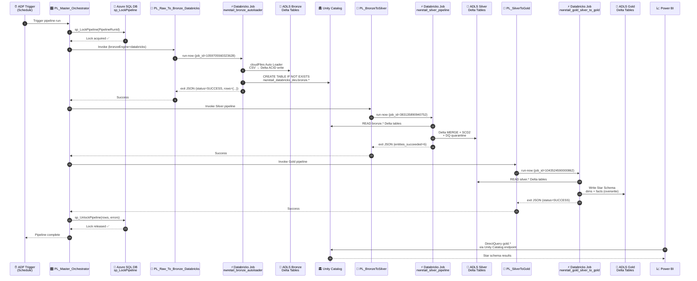

# 🗺️ NorthWind Retail — End-to-End Data Flow Diagram

> **Platform**: Azure Data Factory `demopiplineADF` + Databricks Unity Catalog `nwretail_databricks_dev` + ADLS Gen2 `nwretaildatalake65`

---

## Full End-to-End Pipeline Flow

```mermaid
flowchart TD
    %% ─────────────────────────────────────────────
    %% SOURCE SYSTEMS
    %% ─────────────────────────────────────────────
    subgraph SRC["📦 Source Systems"]
        direction TB
        CSV1["🗃️ stores.csv"]
        CSV2["🗃️ customers.csv"]
        CSV3["🗃️ products.csv"]
        CSV4["🗃️ sales_transactions.csv"]
        CSV5["🗃️ returns.csv"]
        CSV6["🗃️ inventory.csv"]
    end

    %% ─────────────────────────────────────────────
    %% ADLS LANDING ZONE
    %% ─────────────────────────────────────────────
    subgraph ADLS_BRONZE["🏦 ADLS Gen2 · Bronze Container"]
        direction TB
        LAND["📂 abfss://bronze@nwretaildatalake65\n/<entity>/<entity>.csv\n(Landing Zone)"]
        DELTA_BRONZE["🔷 /_delta_tables/<entity>\n(Bronze Delta Lake)"]
        CKPT["📍 /_delta_checkpoints (Auto Loader)\n/_delta_schemas (Schema Registry)"]
    end

    %% ─────────────────────────────────────────────
    %% AZURE DATA FACTORY — MASTER ORCHESTRATOR
    %% ─────────────────────────────────────────────
    subgraph ADF["⚙️ Azure Data Factory · demopiplineADF"]
        direction TB

        MASTER["🎛️ PL_Master_Orchestrator\n(Trigger: Schedule / Manual)\n① Acquire SQL Lock\n② Route bronzeEngine param\n③ Sequence Bronze→Silver→Gold\n④ Release SQL Lock on Completed"]

        subgraph ADF_LOCK["🔐 Concurrency Guard · Azure SQL DB"]
            LOCK_ACQ["sp_LockPipeline\n(PipelineRunId + Timestamp)"]
            LOCK_REL["sp_UnlockPipeline\n(Rows Processed + Error Summary)"]
        end

        PL_BRONZE_DB["🐍 PL_Raw_To_Bronze_Databricks\n(Databricks Linked Service)\nTriggers: Job 1059705560323628"]

        PL_SILVER["🥈 PL_BronzeToSilver\n(Databricks Linked Service)\nTriggers: Job 383135890940752"]

        PL_GOLD["🥇 PL_SilverToGold\n(Databricks Linked Service)\nTriggers: Job 1043524590000862"]

        PL_MAINT["🛠️ PL_Delta_Maintenance\n(Weekly Schedule)\nTriggers: Job 1020298059304865"]
    end

    %% ─────────────────────────────────────────────
    %% DATABRICKS — BRONZE LAYER
    %% ─────────────────────────────────────────────
    subgraph DBX_BRONZE["⚡ Databricks · Bronze Ingestion"]
        direction TB
        NB_AUTOLOADER["📓 NB_Raw_To_Bronze_AutoLoader\nAuto Loader cloudFiles\n• cloudFiles.format = csv\n• schemaEvolutionMode = addNewColumns\n• Trigger.AvailableNow\n• _rescued_data (corrupt rows)\n• Audit: _ingested_at, _source_file,\n  _batch_id, _run_id\nLogger: nwretail.bronze.autoloader"]

        UC_BRONZE["🏛️ Unity Catalog\nnwretail_databricks_dev.bronze.*\n• bronze.stores (7 rows)\n• bronze.customers (200 rows)\n• bronze.products (30 rows)\n• bronze.sales_transactions (1,500 rows)\n• bronze.returns (85 rows)\n• bronze.inventory (4,410 rows)\nFormat: DELTA · Type: EXTERNAL"]
    end

    %% ─────────────────────────────────────────────
    %% ADLS SILVER
    %% ─────────────────────────────────────────────
    subgraph ADLS_SILVER["🏦 ADLS Gen2 · Silver Container"]
        DELTA_SILVER["🔷 abfss://silver@nwretaildatalake65\n/<entity>/\n(Cleansed Delta Lake)"]
        QUARANTINE["🚫 /_quarantine\n(Failed DQ rows + rule name)"]
        OPS["📊 /_ops/run_log\n/_ops/data_quality_summary\n/_ops/entity_watermarks"]
    end

    %% ─────────────────────────────────────────────
    %% DATABRICKS — SILVER LAYER
    %% ─────────────────────────────────────────────
    subgraph DBX_SILVER["⚡ Databricks · Silver Processing"]
        direction TB
        NB_SILVER_ORCH["📓 NB_Bronze_To_Silver\n(Orchestrator)\nDependency ordering:\nstores → customers → products\n→ sales_transactions\n→ returns → inventory\ncontinue_on_error support\nLogger: nwretail.silver.common"]

        NB_SILVER_COMMON["📚 NB_Silver_Common (Library)\n• Auth: Unity Catalog (no storage keys)\n• Schema validation & casting\n• Exact + business-key deduplication\n• SCD Type-2 for customers & products\n  (is_current, valid_from, valid_to)\n• DQ rules → quarantine bad rows\n• Delta MERGE (upsert)\n• Audit: write_run_log()"]

        subgraph SILVER_TABLES["Silver Delta Tables"]
            SIL1["🥈 silver.stores"]
            SIL2["🥈 silver.customers (SCD2)"]
            SIL3["🥈 silver.products (SCD2)"]
            SIL4["🥈 silver.sales_transactions"]
            SIL5["🥈 silver.returns"]
            SIL6["🥈 silver.inventory"]
        end
    end

    %% ─────────────────────────────────────────────
    %% ADLS GOLD
    %% ─────────────────────────────────────────────
    subgraph ADLS_GOLD["🏦 ADLS Gen2 · Gold Container"]
        DELTA_GOLD["🔶 abfss://gold@nwretaildatalake65\n/<table>/\n(Star Schema Delta Lake)"]
    end

    %% ─────────────────────────────────────────────
    %% DATABRICKS — GOLD LAYER
    %% ─────────────────────────────────────────────
    subgraph DBX_GOLD["⚡ Databricks · Gold Modeling"]
        direction TB
        NB_GOLD["📓 NB_Gold_Silver_To_Gold\nStar Schema Builder\nLogger: nwretail.gold.transformation"]

        subgraph GOLD_DIMS["Dimension Tables"]
            DIM1["📐 gold.dim_date"]
            DIM2["📐 gold.dim_store"]
            DIM3["📐 gold.dim_customer (SCD2 current)"]
            DIM4["📐 gold.dim_product (SCD2 current)"]
        end

        subgraph GOLD_FACTS["Fact Tables"]
            FCT1["📊 gold.fact_sales"]
            FCT2["📊 gold.fact_returns"]
            FCT3["📊 gold.fact_inventory"]
        end

        GOLD_VIEWS["👁️ Analytics Views\n• vw_sales_summary\n• vw_inventory_status\n• vw_store_performance"]
    end

    %% ─────────────────────────────────────────────
    %% DATABRICKS MAINTENANCE
    %% ─────────────────────────────────────────────
    subgraph DBX_MAINT["⚡ Databricks · Weekly Maintenance"]
        NB_MAINT["📓 NB_Delta_Maintenance\n• OPTIMIZE (compact small files)\n• ZORDER BY (predicate clustering)\n• VACUUM RETAIN 168 HOURS\nApplied to: all bronze + silver + gold tables\nLogger: nwretail.maintenance.delta"]
    end

    %% ─────────────────────────────────────────────
    %% CONSUMERS
    %% ─────────────────────────────────────────────
    subgraph CONSUMERS["📊 Consumers"]
        PBI["📈 Power BI\n(DirectQuery via Unity Catalog)"]
        SQL["🔍 Databricks SQL\nWarehouse / Serverless"]
        ANALYST["👤 Data Analysts\n(Notebook / SQL Editor)"]
    end

    %% ─────────────────────────────────────────────
    %% GOVERNANCE
    %% ─────────────────────────────────────────────
    subgraph GOV["🏛️ Unity Catalog Governance"]
        UC_GOV["nwretail_databricks_dev\n├── bronze.*  (EXTERNAL DELTA)\n├── silver.*  (EXTERNAL DELTA)\n│   └── silver_ops.run_log\n└── gold.*    (EXTERNAL DELTA)\n    └── Analytics Views"]
    end

    %% ─────────────────────────────────────────────
    %% CICD
    %% ─────────────────────────────────────────────
    subgraph CICD["🔄 CI/CD · GitHub Actions"]
        GH["github.com/iimgaurav/nwretail-data-platform\nbranch: develop\n• Lint + validate ADF JSON\n• ARM Template deploy on merge\n• Databricks notebook import"]
    end

    %% ─────────────────────────────────────────────
    %% CONNECTIONS — DATA FLOW
    %% ─────────────────────────────────────────────

    %% Source → Landing
    CSV1 & CSV2 & CSV3 & CSV4 & CSV5 & CSV6 -->|"Upload to\nbronze container"| LAND

    %% ADF Master starts
    MASTER -->|"① Acquire lock"| LOCK_ACQ
    LOCK_ACQ -->|"Lock granted"| MASTER

    %% ADF → Bronze
    MASTER -->|"② Trigger\nbronzeEngine=databricks"| PL_BRONZE_DB
    PL_BRONZE_DB -->|"Run Databricks Job\n1059705560323628"| NB_AUTOLOADER

    %% Auto Loader reads landing, writes Delta
    LAND -->|"cloudFiles streaming\nread (AvailableNow)"| NB_AUTOLOADER
    NB_AUTOLOADER -->|"ACID Delta write\n+ audit columns"| DELTA_BRONZE
    NB_AUTOLOADER -->|"CREATE TABLE IF NOT EXISTS\n+ register path"| UC_BRONZE
    CKPT -.->|"Checkpoint\nstate"| NB_AUTOLOADER

    %% ADF → Silver
    PL_BRONZE_DB -->|"③ Success\nactivate Silver"| PL_SILVER
    PL_SILVER -->|"Run Databricks Job\n383135890940752"| NB_SILVER_ORCH
    NB_SILVER_ORCH -->|"%run"| NB_SILVER_COMMON

    %% Silver reads Bronze Delta (primary) or CSV fallback
    UC_BRONZE -->|"spark.table()\nbronze.entity\n(Delta read)"| NB_SILVER_COMMON

    %% Silver outputs
    NB_SILVER_COMMON -->|"Delta MERGE\nSCD2 + DQ"| DELTA_SILVER
    NB_SILVER_COMMON -->|"Failed DQ rows\n+ rule tag"| QUARANTINE
    NB_SILVER_COMMON -->|"run_log\nwatermarks\nDQ summary"| OPS
    DELTA_SILVER --> SIL1 & SIL2 & SIL3 & SIL4 & SIL5 & SIL6

    %% ADF → Gold
    PL_SILVER -->|"④ Success\nactivate Gold"| PL_GOLD
    PL_GOLD -->|"Run Databricks Job\n1043524590000862"| NB_GOLD

    %% Gold reads Silver
    SIL1 & SIL2 & SIL3 & SIL4 & SIL5 & SIL6 -->|"spark.table()\nsilver.entity"| NB_GOLD

    %% Gold writes dimensions + facts
    NB_GOLD -->|"Overwrite Delta\nExternal table"| DELTA_GOLD
    DELTA_GOLD --> DIM1 & DIM2 & DIM3 & DIM4
    DELTA_GOLD --> FCT1 & FCT2 & FCT3
    NB_GOLD --> GOLD_VIEWS

    %% Lock release on completion
    MASTER -->|"⑤ Completed\n(success or fail)"| LOCK_REL

    %% Maintenance (weekly, independent)
    PL_MAINT -->|"Weekly trigger\nRun Job 1020298059304865"| NB_MAINT
    NB_MAINT -.->|"OPTIMIZE + ZORDER\n+ VACUUM"| DELTA_BRONZE
    NB_MAINT -.->|"OPTIMIZE + ZORDER\n+ VACUUM"| DELTA_SILVER
    NB_MAINT -.->|"OPTIMIZE + ZORDER\n+ VACUUM"| DELTA_GOLD

    %% Unity Catalog governs all layers
    UC_BRONZE & DELTA_SILVER & DELTA_GOLD --> UC_GOV

    %% Consumers query Gold
    GOLD_VIEWS & DIM1 & DIM2 & DIM3 & DIM4 & FCT1 & FCT2 & FCT3 -->|"Unity Catalog\nSQL / DirectQuery"| PBI
    GOLD_VIEWS & DIM1 & DIM2 & DIM3 & DIM4 & FCT1 & FCT2 & FCT3 -->|"Databricks SQL\nWarehouse"| SQL
    SQL --> ANALYST

    %% CI/CD deploys ADF + Databricks
    GH -.->|"ARM deploy\non merge to main"| ADF
    GH -.->|"Notebook import\nDatabricks Workspace API"| DBX_BRONZE
    GH -.->|"Notebook import\nDatabricks Workspace API"| DBX_SILVER
    GH -.->|"Notebook import\nDatabricks Workspace API"| DBX_GOLD

    %% ─────────────────────────────────────────────
    %% STYLES
    %% ─────────────────────────────────────────────
    classDef adf fill:#0078d4,color:#fff,stroke:#005a9e,stroke-width:2px
    classDef databricks fill:#ff3621,color:#fff,stroke:#cc0000,stroke-width:2px
    classDef adls fill:#00b294,color:#fff,stroke:#007a63,stroke-width:2px
    classDef catalog fill:#8661c5,color:#fff,stroke:#5e3fa0,stroke-width:2px
    classDef consumer fill:#f2c811,color:#000,stroke:#c9a500,stroke-width:2px
    classDef cicd fill:#333,color:#fff,stroke:#000,stroke-width:2px
    classDef source fill:#e8f4fd,color:#000,stroke:#0078d4,stroke-width:1px

    class MASTER,PL_BRONZE_DB,PL_SILVER,PL_GOLD,PL_MAINT,LOCK_ACQ,LOCK_REL adf
    class NB_AUTOLOADER,NB_SILVER_ORCH,NB_SILVER_COMMON,NB_GOLD,NB_MAINT databricks
    class LAND,DELTA_BRONZE,CKPT,DELTA_SILVER,QUARANTINE,OPS,DELTA_GOLD adls
    class UC_BRONZE,UC_GOV,GOLD_VIEWS catalog
    class PBI,SQL,ANALYST consumer
    class GH cicd
    class CSV1,CSV2,CSV3,CSV4,CSV5,CSV6 source
```

---

## Pipeline Execution Sequence

---

## Layer Summary

| Layer | Storage | Format | Key Notebook | ADF Pipeline | Row Count |
|:------|:--------|:-------|:------------|:-------------|:----------|
| **Landing** | `bronze@nwretaildatalake65` | CSV files | — | — | Raw |
| **Bronze** | `bronze/_delta_tables/*` | Delta (EXTERNAL) | `NB_Raw_To_Bronze_AutoLoader` | `PL_Raw_To_Bronze_Databricks` | 6,232 |
| **Silver** | `silver@nwretaildatalake65/*` | Delta (EXTERNAL) | `NB_Bronze_To_Silver` | `PL_BronzeToSilver` | 6,002 |
| **Gold** | `gold@nwretaildatalake65/*` | Delta (EXTERNAL) | `NB_Gold_Silver_To_Gold` | `PL_SilverToGold` | Dimensional |
| **Maintenance** | All layers | — | `NB_Delta_Maintenance` | `PL_Delta_Maintenance` | Weekly |

> **Commit**: `879ce86` on `origin/develop`
