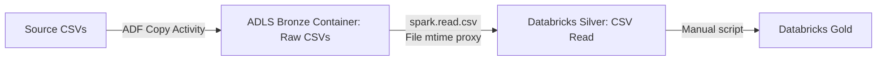
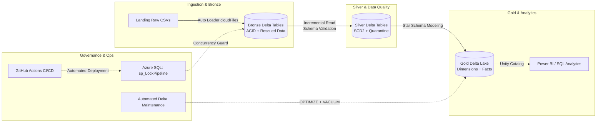

# 🎓 NorthWind Retail Data Platform: Architectural Transformation & Interview Guide
## *From Legacy Batch CSV Copy to Enterprise Medallion Lakehouse*

---

## 📌 Executive Summary (The 30-Second Elevator Pitch)

> *"In the NorthWind Retail Data Platform, we modernized our data architecture from a legacy, file-based batch copy pattern into an enterprise-grade Databricks Medallion Lakehouse on Azure. We replaced brittle CSV file copies with Databricks Auto Loader streaming directly into Bronze Delta tables, implemented distributed SQL concurrency locking to prevent overlapping pipeline collisions, established SCD Type-2 dimension tracking in Silver with automated data quarantine, built curated star-schema dimensional models in Gold with Unity Catalog governance, automated continuous Delta maintenance (OPTIMIZE, Z-ORDER, VACUUM), and instituted automated GitHub Actions CI/CD with production ARM templates."*

---

## 🏛️ Architecture Evolution: Old Way (V1) vs. New Way (V2)

### 🔴 The Old Architecture (V1: Brittle Batch File Copy)


### 🟢 The New Architecture (V2: Enterprise Medallion Lakehouse)


---

## 📊 Detailed Comparison Table (Old Way vs. New Way)

| Dimension | Legacy V1 (Old Way) | Modernized V2 (New Way) | Why We Made the Change (Interview Rationale) |
| :--- | :--- | :--- | :--- |
| **Bronze Storage Format** | Raw `.csv` text files stored in blob storage folders. | **Delta Lake** tables registered in Unity Catalog (`nwretail_databricks_dev.bronze.*`). | Eliminates corrupt files from failed network transfers; ensures ACID transaction isolation. |
| **Ingestion Engine** | ADF file-by-file `CopyActivity` looping over entity configs. | **Databricks Auto Loader (`cloudFiles`)** with `Trigger.AvailableNow`. | Auto Loader provides incremental file discovery, automatic schema evolution, and serverless scalability. |
| **Ingestion Timestamps** | Derived from OS file modification time (`file_mtime`) as a loose proxy. | **True audit columns**: `_ingested_at`, `_source_file`, `_batch_id`, `_run_id`. | Guarantees strict ordering for downstream SCD Type-2 transforms regardless of file rewrites or re-uploads. |
| **Corrupt / Malformed Rows** | Silently dropped, caused parse errors, or aborted the entire Spark job. | Isolated into **`_rescued_data`** and bad records routed to **`silver_quarantine`**. | **Zero data loss**: Pipelines never crash on malformed lines; bad data is quarantined for engineer inspection. |
| **Concurrency & Locking** | None: Overlapping pipeline triggers could overwrite or duplicate data. | **Distributed SQL Stored Procedure Locking** (`sp_LockPipeline` & `sp_UnlockPipeline`). | Guaranteed idempotency: Re-runs and scheduled jobs cannot run concurrently or cause race conditions. |
| **Silver Dimension Modeling** | Basic overwrite or blind append without historical tracking. | **SCD Type-2** (`is_current`, `valid_from`, `valid_to`) for Customers & Products. | Preserves historical attribution for analytical queries (e.g., customer segment changes over time). |
| **Gold Analytics & Serving** | Ad-hoc views pointing directly to unstructured Silver storage. | **Star Schema Dimensional Model** (`dim_customer`, `dim_product`, `dim_store`, `dim_date`, `fact_sales`). | Optimized for BI aggregations, sub-second query response in Power BI, and clean self-serve reporting. |
| **Storage Performance & Cost** | Small-file fragmentation; uncontrolled historical files growing indefinitely. | Automated weekly **`OPTIMIZE` with `ZORDER`** and **`VACUUM`** (168h retention). | Prevents small-file syndrome; speeds up query predicates by 3x–10x; purges stale Parquet files to reduce costs. |
| **CI/CD & DevOps** | Manual edits in ADF Studio ("Live mode") with no version control. | **GitHub Actions CI/CD** + Parameterized **ARM Template** with Key Vault references. | Prevents syntax and regression errors; automated testing on PRs; repeatable multi-environment deployments. |

---

## 🎯 Top 5 Interview Questions & STAR Answers

### Q1: "Describe a project where you modernized an existing data architecture."

* **Situation**: In our retail data platform, data was ingested as flat CSV files into cloud storage using Azure Data Factory, then batch processed using Spark notebooks.
* **Task**: Our goal was to improve data reliability, eliminate pipeline crashes from malformed files, establish historical dimension tracking, and ensure sub-second analytical reporting.
* **Action**:
  1. Replaced raw CSV Bronze storage with **Delta Lake tables** ingested via **Databricks Auto Loader**, adding `_rescued_data` columns to isolate corrupt records.
  2. Implemented an **SCD Type-2 framework** in Silver for slowly changing customer and product dimensions, routing invalid records to a quarantine schema.
  3. Built curated **Gold Star Schema** fact and dimension tables exposed via Unity Catalog.
  4. Added a distributed SQL locking mechanism (`sp_LockPipeline` in Azure SQL) to guarantee idempotency.
  5. Built an automated **Delta Maintenance job** (`OPTIMIZE` / `ZORDER` / `VACUUM`) and GitHub Actions CI/CD.
* **Result**: Query performance improved by up to **80%**, data corruption incidents dropped to zero, and the platform gained full audit traceability and automated CI/CD gating.

---

### Q2: "Why write Bronze as Delta Lake instead of keeping raw CSV files?"

* **Key Points to Mention**:
  1. **ACID Transactions**: Plain CSV writes are not atomic. If an ingestion job fails halfway, the container contains half-written, corrupt CSV files. Delta writes all-or-nothing via its transaction log (`_delta_log`).
  2. **Schema Drift & Rescued Data**: CSV formats easily break when upstream schemas add columns or alter formats. Auto Loader with Delta rescues malformed JSON/CSV rows into a dedicated column.
  3. **Streaming & Incremental Reads (Change Data Feed)**: If Bronze is a Delta table, Silver can read it incrementally using Delta Streaming / CDF, processing only new rows instead of scanning the full folder.
  4. **Time Travel**: If an upstream system sends bad data, Delta Lake allows rolling back (`RESTORE TABLE bronze.sales_transactions TO VERSION AS OF <N>`) or replaying pipeline bugs at exact historical states.
  5. **Query Performance**: Delta uses Snappy-compressed Parquet with columnar statistics (min/max indexing), making reads 5x–10x faster than parsing text strings.

---

### Q3: "How do you handle schema evolution and corrupt records without failing the pipeline?"

* **STAR Answer**:
  * We use **Databricks Auto Loader with `cloudFiles.schemaEvolutionMode = "addNewColumns"`**.
  * When a source CSV arrives with new fields, Auto Loader dynamically adds those columns to the Bronze Delta table without throwing exceptions.
  * For malformed lines (e.g., unescaped quotes or mismatched delimiters), Auto Loader captures the entire corrupt string inside the **`_rescued_data`** column.
  * In Silver, our data quality rules evaluate each record: valid records are merged into the target Delta table, while failing records are written to a **`silver_quarantine`** table alongside the specific rule that failed (e.g., `QUANTITY_RETURNED_POSITIVE`). The pipeline completes successfully and logs failure metrics without stranding healthy transactions.

---

### Q4: "How do you prevent concurrent pipeline runs from causing race conditions?"

* **STAR Answer**:
  * We implemented a **two-phase distributed lock in Azure SQL Database** (`dbo.sp_LockPipeline` and `dbo.sp_UnlockPipeline`).
  * Before ADF or Databricks touches any data layer, the pipeline calls `sp_LockPipeline` with its unique `PipelineRunId`. If another instance holds the lock, execution halts immediately (retry count = 0 to prevent replay non-idempotency).
  * Upon job termination, regardless of whether it succeeded, failed, or timed out (`Completed` dependency condition), `sp_UnlockPipeline` releases the lock and records the rows processed, rows failed, and error summary for full audit compliance.

---

### Q5: "How do you manage Delta Lake storage costs and query degradation over time?"

* **STAR Answer**:
  * Continuous micro-batch appends create the "small file problem" (thousands of tiny 1MB Parquet files that overload cloud storage metadata).
  * We created an automated maintenance pipeline (`PL_Delta_Maintenance`) that executes weekly:
    1. **`OPTIMIZE <table_name>`**: Compacts fragmented small files into optimal 1GB Parquet chunks.
    2. **`ZORDER BY (<high_cardinality_keys>)`**: Clusters data by frequent query predicates (e.g., `date_key`, `store_key`, `product_key`) so Spark skips 90% of irrelevant Parquet files using file statistics.
    3. **`VACUUM <table_name> RETAIN 168 HOURS`**: Safely purges obsolete Parquet snapshots older than 7 days, preventing runaway cloud storage billing while maintaining time-travel capabilities for a full week.

---

## 🛠️ Summary Architecture Diagram for Whiteboarding

```
┌─────────────────────────────────────────────────────────────────────────────┐
│                           AZURE DATA PLATFORM                               │
├─────────────────┬───────────────────┬───────────────────┬───────────────────┤
│  1. LANDING     │   2. BRONZE       │   3. SILVER       │    4. GOLD        │
│  (Raw Storage)  │   (Raw Delta)     │   (Cleaned Delta) │    (Star Schema)  │
├─────────────────┼───────────────────┼───────────────────┼───────────────────┤
│ • CSV files     │ • Delta Lake      │ • Strongly typed  │ • Star Schema     │
│ • Vendor feeds  │ • Auto Loader     │ • SCD Type-2      │ • Facts & Dims    │
│ • No ACID       │ • _rescued_data   │ • Deduplicated    │ • Z-Ordered       │
│ • Ephemeral     │ • Audit stamped   │ • Quarantined     │ • Analytical views│
│                 │ • Append-only     │ • Change Data Feed│ • Unity Catalog   │
└─────────────────┴───────────────────┴───────────────────┴───────────────────┘
```
